# Laporan Proyek Socialvest

---

## 1. Ringkasan aplikasi

Socialvest adalah aplikasi edukasi dan pencatatan investasi untuk pengguna ritel. Aplikasi
menggabungkan empat hal dalam satu alur:

1. **Portofolio** — mencatat aset, pembelian/penjualan, serta menghitung nilai portfolio
   dan laba/rugi secara konsisten.
2. **Cari** — katalog simbol saham IDX dan kripto dengan kutipan harga sesekali dari
   Yahoo Finance/CoinGecko, selalu berlabel sumber dan jam pengambilan.
3. **Social** — feed komunitas untuk berbagi pengalaman, dengan like dan komentar.
4. **Learn** — katalog kursus berbasis playlist YouTube (36 video dari kanal Saham
   dari Nol), pemutar embed resmi, dan progres belajar per modul.

Semua modul dihubungkan oleh **Home dashboard**. Bottom navigation berisi
**Home · Social · Cari · Learn · Portofolio**. Profil bukan lagi tab: profil dibuka dari
**drawer kiri**, yang juga memuat Akun & keamanan, Pengaturan, Tema aplikasi, Notifikasi,
Bahasa, Privasi, Syarat penggunaan, Kebijakan privasi, dan Keluar.

Prinsip yang dipegang sepanjang proyek:

- Harga adalah **harga tersimpan terakhir** (input manual atau kutipan sesekali), bukan
  feed real-time. Setiap layar memberi label sumber, jam, dan peringatan.
- Hasil pencarian di tab Cari **hanya mengisi formulir aset**; transaksi tetap dibuat
  manual oleh pengguna, tidak ada eksekusi order otomatis.
- Postingan komunitas diberi label **opini pengguna**, bukan nasihat keuangan.
- Tidak ada tombol atau pesan sukses palsu. Empty state dan error state ditampilkan apa
  adanya, termasuk kegagalan pengambilan harga.
- Data portfolio hanya dapat dibaca pemiliknya, ditegakkan oleh `firestore.rules`.

---

## 2. Fitur yang sudah berjalan

| Modul | Fitur |
|---|---|
| Autentikasi | Register, login, logout, sesi bertahan, validasi form, pesan error Firebase |
| Profil | Lihat/edit nama, username, bio; email hanya dari sesi Auth; profil publik pengguna lain |
| Portofolio | CRUD aset, BUY/SELL, rata-rata (average cost), unrealized & realized P/L, riwayat transaksi, hapus transaksi dengan validasi oversell |
| Refresh harga | Tombol “Refresh semua” mengambil harga kripto (CoinGecko), saham & emas (Yahoo Finance) dengan label sumber dan ringkasan hasil |
| Cari | Katalog statis 51 simbol (26 saham IDX + 25 kripto), pencarian nama/ticker, filter Semua/Saham/Kripto, kutipan otomatis untuk semua simbol terlihat sekali saat tab dibuka, tombol "Perbarui harga" manual yang memaksa data baru, daftar gagal yang jujur |
| Social | Feed publik, buat/edit/hapus post, like anti-duplikat, komentar + hapus komentar, profil publik penulis |
| Learn | Katalog playlist bawaan **Belajar Saham dari Nol!** (36 video, kanal Saham dari Nol) tanpa seed, detail kursus + silabus durasi, tombol buka playlist, enroll, pemutar embed YouTube, tandai selesai per modul, progres bertahan setelah restart |
| Home | Sapaan + avatar, ringkasan portfolio sendiri, 3 post terbaru, 2 kursus unggulan, shortcut tab (Portofolio/Social/Learn) |
| Drawer | Header akun (inisial, nama, username, email) + navigasi ke profil, akun, pengaturan, tema, notifikasi, bahasa, privasi, dan dokumen legal |
| Akun & keamanan | Data akun read-only, reset kata sandi nyata lewat `sendPasswordResetEmail`, hasil sukses/gagal apa adanya, catatan batas akun demo |
| Tema aplikasi | Sistem / Terang / Gelap, tersimpan di `SharedPreferences` dan diterapkan lewat `AppCompatDelegate` |
| Dokumen legal | Syarat penggunaan & Kebijakan privasi statis dengan catatan “dokumen tugas akademik” |
| Settings | Data akun read-only, ringkasan privasi, disclaimer wajib, kebijakan penghapusan data, versi aplikasi, logout |

Bottom navigation: **Home · Social · Cari · Learn · Portofolio** (Cari di tengah).
Profil, Akun & keamanan, Pengaturan, dan dokumen legal dibuka dari drawer.

---

## 3. Arsitektur dan teknologi

- **Bahasa:** Kotlin, Gradle Kotlin DSL, `minSdk 24`, `targetSdk 36`, `compileSdk 37`.
- **UI:** XML + View Binding + Material 3. Tanpa Compose, tanpa library gambar eksternal.
- **Pola:** MVVM + Repository.
  `Activity/Fragment → ViewModel (StateFlow) → Repository → Firebase`.
- **Firebase:** Authentication (email/password) dan Cloud Firestore. Tidak memakai
  Firebase Storage karena tidak ada upload gambar.
- **Perhitungan uang:** `Long` sen (1/100 rupiah) dan kuantitas `Long` × 1.000.000;
  perkalian memakai `BigInteger`/`BigDecimal`, bukan `Double`.
- **Kutipan pasar:** `MarketQuoteService` memanggil Yahoo Finance (`TICKER.JK`) dan
  CoinGecko (`vs_currencies=idr`). Saham dikirim bertahap 8 simbol per batch dengan jeda
  500 ms agar satu penekanan mencakup semua simbol terlihat; kutipan di-cache 120 detik
  dan dipakai bersama antar tab, sedangkan tombol manual memaksa data baru. Tidak ada
  auto-refresh berulang; hanya sekali saat tab Cari dibuka dan saat tombol ditekan.
- **Tema:** `ThemePreference` menyimpan pilihan di `SharedPreferences`
  (`app_theme` = `system`/`light`/`dark`), dibaca di `Application.onCreate`.
- **Pengujian:** JUnit di JVM untuk aturan bisnis yang bebas Android.

### Struktur paket utama

```text
com.socialvest.app
├── data/model/        User, Asset, Transaction, Post, Comment, Course, ...
├── data/repository/   Auth, Investment, Social, Learning
├── data/remote/       PriceService, MarketQuoteService, parser JSON, HttpTextClient
├── domain/            PortfolioCalculator, PortfolioSummary, SocialFeed,
│                      Learning, YoutubeVideo, StarterCatalog (katalog playlist),
│                      price/, market/MarketCatalog
├── viewmodel/         satu ViewModel per layar (termasuk Search, AccountSecurity)
├── ui/                auth, home, invest, search, social, learning,
│                      profile, settings (Settings, AccountSecurity, Legal)
└── utils/             Validators, ErrorMapper, Money, Quantity, Display,
                       RemoteImage, WindowInsets, ThemePreference
```

Catatan: tab **Portofolio** memakai ulang seluruh layar Invest lama, sehingga nama
kelas/layout internal tetap `Invest*`; hanya id navigasi dan label yang berubah.

Detail lengkap ada di [`SETUP.md`](SETUP.md).

---

## 4. Model data Firestore

| Path | Isi | Hak akses |
|---|---|---|
| `users/{uid}` | `fullName`, `username`, `bio`, `photoUrl`, `role`, `createdAt` | Baca publik terbatas, tulis pemilik |
| `portfolios/{uid}` | portfolio per akun | Pemilik |
| `assets/{assetId}` | agregat aset: `quantity`, `totalCost`, `averageBuyPrice`, `currentPrice`, `realizedPl` | Pemilik |
| `transactions/{txId}` | BUY/SELL: `quantity`, `pricePerUnit`, `fee`, tanggal | Pemilik |
| `posts/{postId}` | `content`, `category`, `authorName`, `likeCount`, `commentCount` | Baca semua pengguna masuk, tulis pemilik |
| `posts/{postId}/likes/{uid}` | like (ID = UID, anti-duplikat) | Pemilik like |
| `posts/{postId}/comments/{commentId}` | komentar | Baca semua, tulis pemilik |
| `courses/{courseId}` + `modules` | kursus tambahan (seed opsional Console); katalog utama dibundel di `StarterCatalog` dan tidak disimpan di Firestore | Read-only |
| `enrollments/{uid}_{courseId}` | status ikut kursus | Pemilik |
| `progress/{uid}_{courseId}_{moduleId}` | status selesai per modul | Pemilik |

Aturan keamanan lengkap ada di [`firestore.rules`](firestore.rules). Untuk proyek ini
tidak diperlukan composite index karena query memakai equality dan pengurutan di klien.
Katalog Cari, pilihan tema, dan dokumen legal tidak disimpan di Firestore.

---

## 5. Tampilan aplikasi

### 5.1 Home

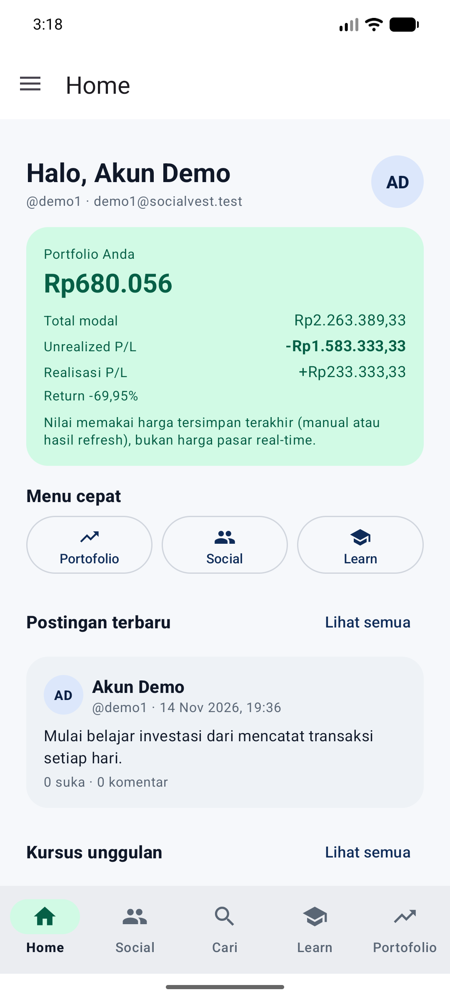

Sapaan, avatar inisial, ringkasan portfolio milik sendiri (modal, unrealized/realisasi
P/L, return), catatan harga tersimpan terakhir, shortcut Portofolio/Social/Learn,
pratinjau post dan kursus.

### 5.2 Portofolio

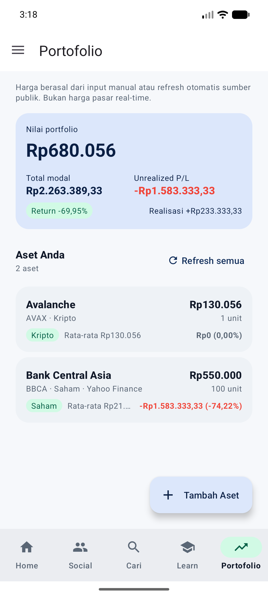

Nilai portfolio, total modal, P/L, return, serta daftar aset dengan label sumber harga
(Yahoo Finance) dan tombol “Refresh semua”.

### 5.3 Social

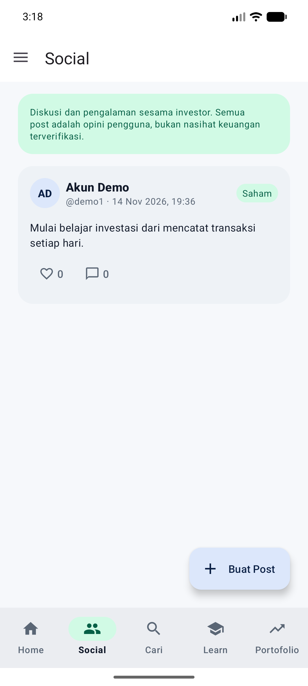

Feed dengan penulis, waktu, topik, isi, jumlah suka/komentar, serta penanda bahwa semua
post adalah opini pengguna.

### 5.4 Learn

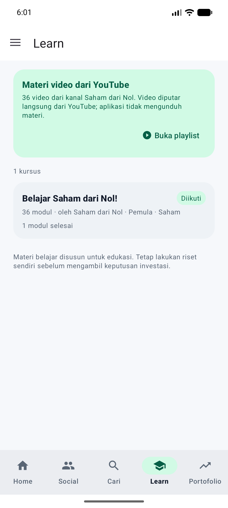

Banner sumber menyebut **36 video dari kanal Saham dari Nol** dan menyediakan tombol
**Buka playlist**. Katalog berisi satu kursus playlist `Belajar Saham dari Nol!` dengan
meta "36 modul · oleh Saham dari Nol · Pemula · Saham", status `Diikuti`, dan jumlah
modul selesai. Katalog langsung tampil tanpa seeding; hanya enrollment/progres yang
disimpan di Firestore.

### 5.5 Detail kursus

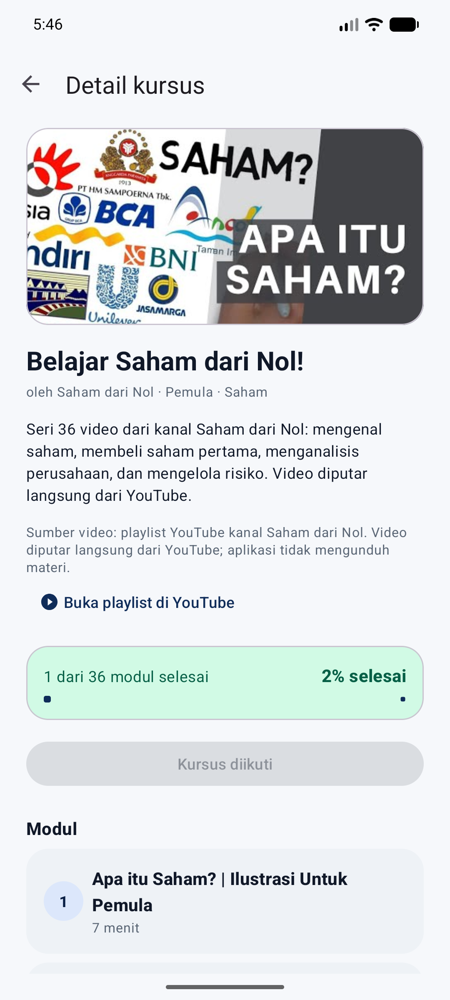

Thumbnail video pertama, deskripsi netral, catatan sumber + tombol
**Buka playlist di YouTube**, progres `1 dari 36 · 2%`, status kursus diikuti, dan silabus
36 modul sesuai urutan playlist lengkap dengan durasi. Video tetap milik kanalnya;
aplikasi hanya memutar/menautkan, tidak mengunduh.

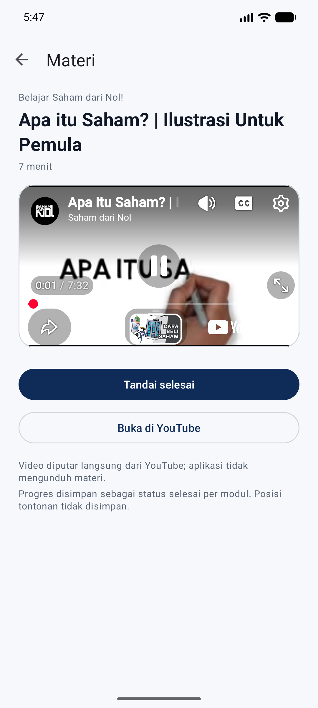

Player modul memakai embed resmi YouTube di dalam WebView (terlihat `0:01 / 7:32`),
dengan tombol **Buka di YouTube** sebagai fallback dan catatan bahwa progres hanya
menyimpan status selesai.

### 5.6 Profil

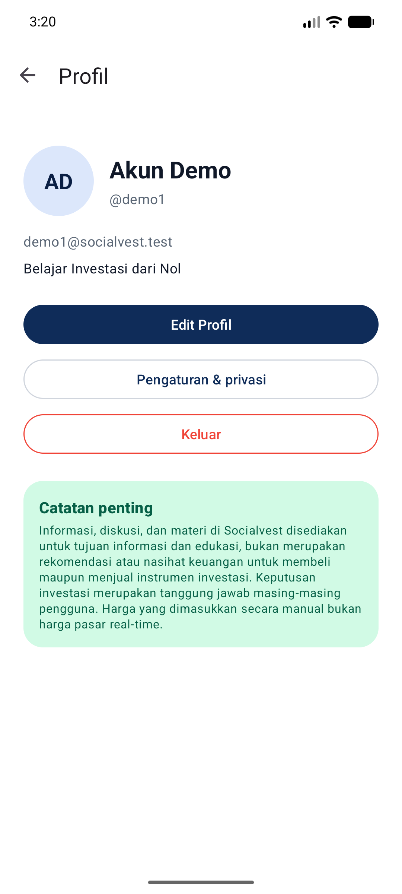

Dibuka dari drawer; bottom navigation disembunyikan dan toolbar menjadi panah kembali.
Berisi data profil, bio, tombol edit, Pengaturan & privasi, logout, dan disclaimer.

### 5.7 Cari

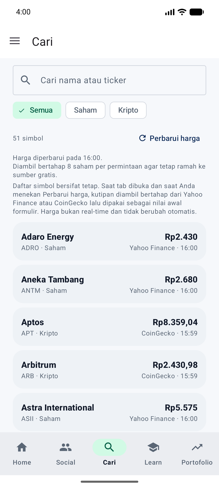

Katalog 51 simbol dengan kutipan saham (Yahoo Finance) dan kripto (CoinGecko). Setiap
harga menyertakan sumber dan jam pengambilan. Satu penekanan "Perbarui harga" mengambil
semua simbol terlihat (saham dikirim bertahap 8 per permintaan, ±7–9 detik) dan menolak
cache; layar menjelaskan sifat daftar yang statis dan bahwa harga tidak berubah otomatis.

### 5.8 Formulir aset terisi dari Cari

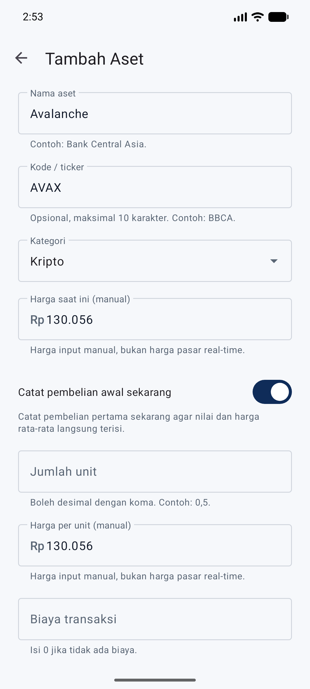

Mengetuk hasil pencarian membuka `AssetFormActivity` dengan nama, ticker, kategori, dan
harga terisi. Pengguna tetap harus memilih jumlah unit dan menyimpan sendiri; tidak ada
transaksi otomatis.

### 5.9 Drawer

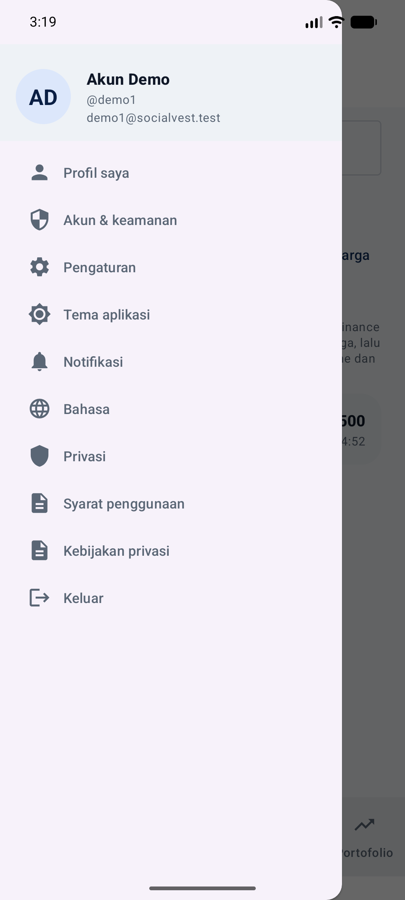

Header akun dan menu Profil saya, Akun & keamanan, Pengaturan, Tema aplikasi, Notifikasi,
Bahasa, Privasi, Syarat penggunaan, Kebijakan privasi, Keluar.

### 5.10 Akun & keamanan

| Akun & keamanan | Hasil reset kata sandi |
|---|---|
| 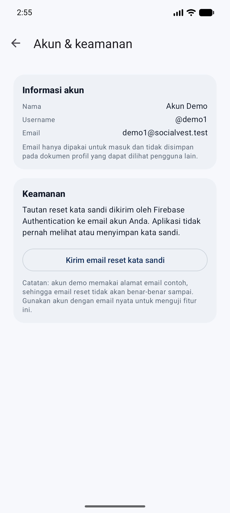 | 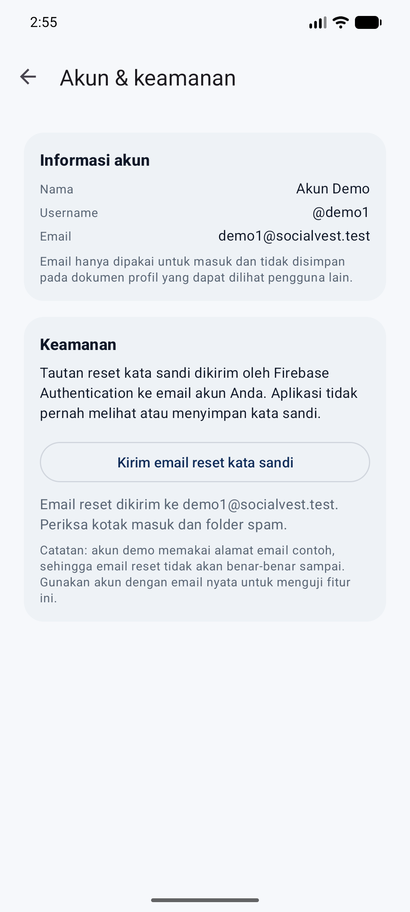 |

Data akun read-only dan tombol kirim email reset yang benar-benar memanggil Firebase.
Hasil ditampilkan apa adanya, disertai catatan bahwa akun demo memakai domain contoh
sehingga email tidak akan sampai.

### 5.11 Dokumen legal

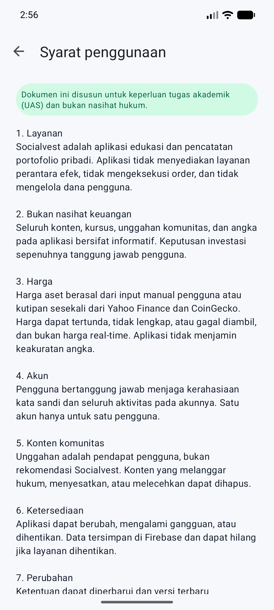

Syarat penggunaan dan Kebijakan privasi statis dengan catatan eksplisit bahwa dokumen
disusun untuk tugas akademik, bukan nasihat hukum.

### 5.12 Tema aplikasi

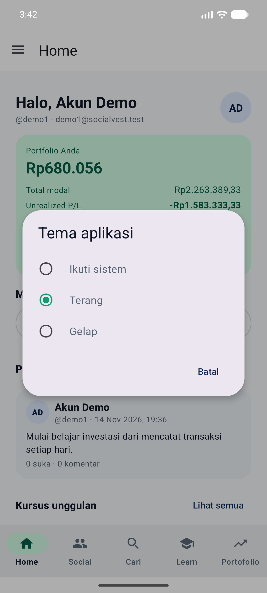

Pilihan Sistem / Terang / Gelap; perubahan langsung diterapkan dan bertahan setelah
aplikasi dibuka ulang.

### 5.13 Settings & privasi

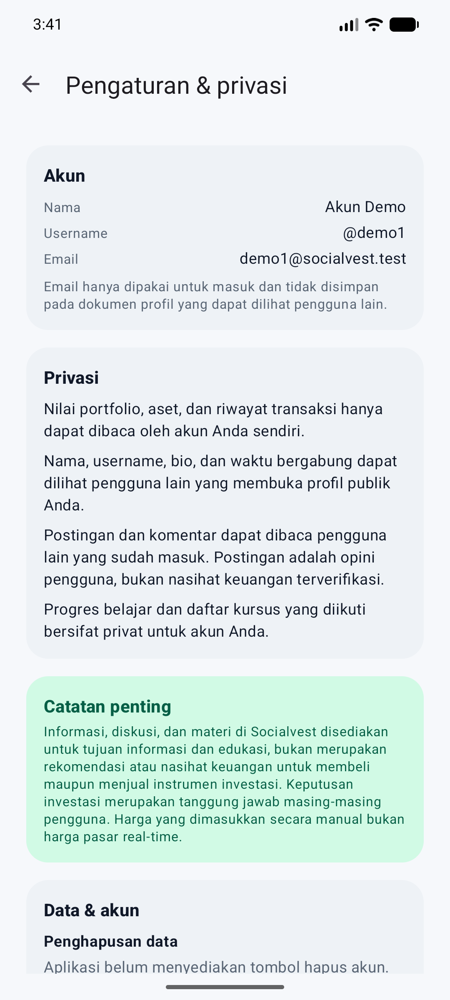

Data akun read-only, ringkasan privasi, disclaimer wajib, kebijakan penghapusan data,
versi aplikasi, dan logout.

### 5.14 Dark mode

| Home | Portofolio |
|---|---|
| 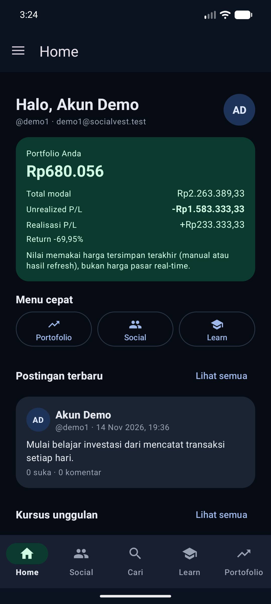 | 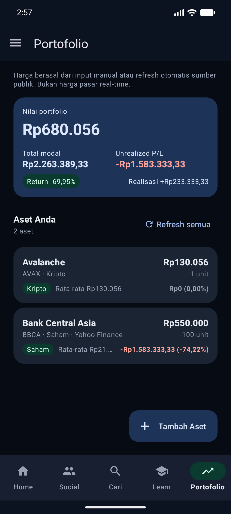 |

### 5.15 Notifikasi (read-only)

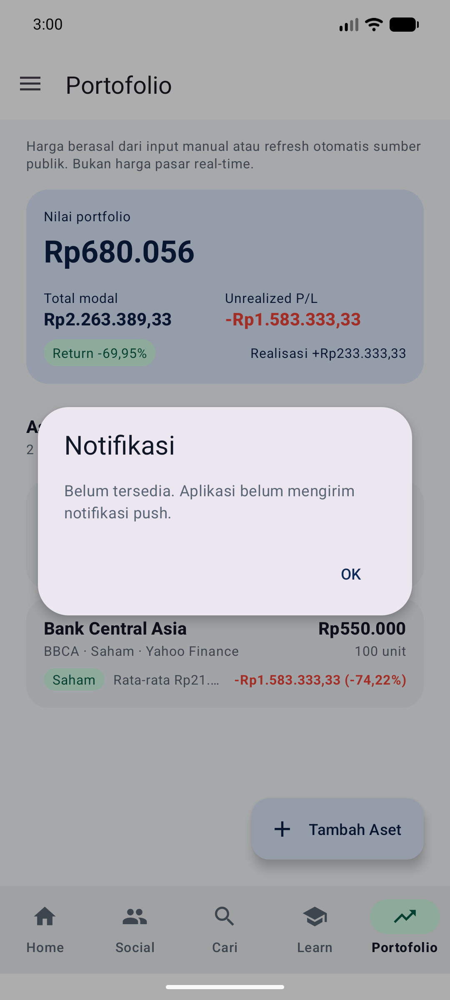

Notifikasi dan Bahasa sengaja hanya menampilkan penjelasan karena belum ada push
notification dan aplikasi hanya berbahasa Indonesia — bukan toggle palsu.

---

## 6. Pengujian

### 6.1 Unit test (JVM)

Dijalankan dengan `.\gradlew.bat :app:testDebugUnitTest`.

| Suite | Jumlah | Fokus |
|---|---:|---|
| `PortfolioCalculatorTest` | 18 | Average cost, BUY/SELL, oversell, pembulatan |
| `LearningTest` | 12 | Urutan kursus/modul, persentase, durasi, ID YouTube |
| `MarketCatalogTest` | 8 | Ukuran katalog, keunikan ticker, filter kategori, ranking, sinkronisasi id CoinGecko dengan `SymbolResolver` |
| `QuoteFetchPlannerTest` | 10 | Urutan retry-first, ukuran batch 8, cakupan seluruh katalog, tanpa duplikat, kategori, daftar kosong |
| `PriceRefreshPlannerTest` | 8 | Pemilihan aset yang bisa di-refresh, batas 10 aset |
| `SocialFeedTest` | 7 | Urutan terbaru, paging, validasi panjang teks |
| `PriceJsonParserTest` | 6 | Parsing respons CoinGecko/Yahoo |
| `PriceMathTest` | 6 | Konversi harga & pembulatan |
| `PortfolioSummaryTest` | 5 | Total portfolio Home = Portofolio, kasus kosong/terjual semua |
| `StarterCatalogTest` | 10 | 1 kursus playlist, 36 modul berurutan, ID unik, ID YouTube valid, durasi total, merge tanpa duplikat |
| **Total** | **90** | **0 gagal** |

### 6.2 Pengujian manual di emulator

Sudah dijalankan pada emulator Pixel 7a (API 37), light & dark mode:

- Login, profil dari drawer, edit profil, logout.
- Portofolio: tambah aset, BUY/SELL, detail aset, riwayat, hapus transaksi, hapus aset,
  “Refresh semua” untuk 4 aset.
- Cari: satu penekanan "Perbarui harga" mengisi **semua 51 simbol** (26 saham + 25 kripto)
  dengan label sumber + jam; pencarian ticker dan filter kategori bekerja; menekan ulang
  mengubah jam kutipan (tidak memakai cache); pindah tab lalu kembali mempertahankan
  kutipan dan posisi gulir; mode pesawat menampilkan "Harga tidak tersedia" beserta jumlah
  gagal, tanpa harga karangan.
- Prefill: mengetuk hasil Cari → formulir terisi (Avalanche/AVAX/Kripto, Rp130.056) →
  simpan → aset muncul di Portofolio dan total berubah menjadi Rp680.056 (2 aset).
- Social: buat/edit/hapus post, like/unlike (tanpa duplikat), komentar, profil publik.
- Learn: katalog bawaan tanpa seed menampilkan 1 kursus/36 modul; enroll; modul 1 diputar
  di embed YouTube (`0:01 / 7:32`) dengan kontrol lengkap; "Buka di YouTube" membuka video
  yang sama; "Tandai selesai" menghasilkan `1 dari 36` (2%) dan centang modul; status
  enrollment + progres tetap sama setelah `force-stop` dan aplikasi dibuka ulang.
- Home: seluruh kartu, shortcut, buka detail post/kursus.
- Drawer: semua item membuka layar/dialog yang benar; profil menyembunyikan bottom bar
  dan panah kembali mengembalikannya.
- Akun & keamanan: data akun benar, dialog konfirmasi reset, hasil Firebase nyata.
- Tema: Terang dan Gelap diterapkan tanpa kehilangan sesi dan bertahan setelah restart.
- Legal: Syarat penggunaan dan Kebijakan privasi terbuka dari drawer.
- Logcat bersih, tidak ada `FATAL EXCEPTION`.

### 6.3 Acceptance criteria

Peta lengkap 14 kriteria brief ada di
[`SETUP.md` bagian 16](SETUP.md#16-peta-acceptance-criteria-brief-bagian-11).
**Semua 14 kriteria lulus**; kriteria 10 (memutar video kursus) dan 11 (progres belajar
tersimpan) kini diuji end-to-end memakai katalog playlist bawaan, tanpa seed manual.

---

## 7. Batasan yang diakui

- **Harga bukan real-time.** Harga berasal dari input manual atau kutipan sesekali dari
  sumber publik gratis; dapat tertunda, tidak lengkap, atau gagal diambil, dan selalu
  diberi label sumber + jam. Tab Cari tidak memperbarui harga secara otomatis setelah
  pemuatan pertama.
- **Katalog Cari bersifat statis** (51 simbol pilihan), bukan seluruh bursa. Saham dikirim
  bertahap 8 simbol per batch (jeda 500 ms) agar tetap ramah ke Yahoo Finance, tetapi satu
  penekanan tetap mencakup semua saham terlihat; kripto memakai satu permintaan batch
  CoinGecko. Ticker yang benar-benar ditolak sumber tetap "Harga tidak tersedia" dan bisa
  dicoba ulang.
- **Katalog Learn dibundel di aplikasi.** Satu playlist = satu kursus; menambah playlist
  berarti mengubah `StarterCatalog` dan merilis ulang aplikasi, atau menambahkan dokumen
  `courses` lewat Console. Tidak ada admin UI/importer playlist otomatis.
- **Video milik pihak ketiga.** Kanal Saham dari Nol dapat menghapus video, membatasi
  embed, atau menutup playlist kapan saja; aplikasi hanya memutar/menautkan dari YouTube
  dan tidak menyimpan salinan. Bila embed diblokir, pengguna diarahkan ke YouTube.
- **Reset kata sandi nyata, hapus akun masih manual.** `sendPasswordResetEmail` sudah
  berfungsi, tetapi akun demo memakai domain `socialvest.test` sehingga email tidak akan
  sampai. Penghapusan akun dan seluruh data Firestore dilakukan manual oleh pengembang.
- **Notifikasi dan Bahasa belum tersedia.** Tidak ada FCM dan aplikasi hanya berbahasa
  Indonesia; kedua item drawer menampilkan penjelasan, bukan toggle palsu.
- **Progres belajar hanya status selesai** per modul; posisi tontonan tidak disimpan.
- **Satu portfolio per akun**, tanpa multi-currency dan tanpa grafik performa (grafik di
  luar cakupan brief).
- **Feed maksimal 100 post per sesi** dan tanpa pencarian/filter topik.
- Semua keterbatasan lain didokumentasikan di `SETUP.md` bagian 14.

---

## 8. Cara menjalankan

1. Buka folder proyek di Android Studio (JDK 17+, Android SDK 37).
2. Pastikan `app/google-services.json` tersedia dan paketnya `com.socialvest.app`.
3. Publikasikan `firestore.rules` di Firebase Console (project `socialvest-uas`).
4. Build & install:

   ```bat
   .\gradlew.bat :app:assembleDebug
   adb install -r app\build\outputs\apk\debug\app-debug.apk
   ```

5. Login memakai akun yang terdaftar di Firebase Authentication
   (contoh: `demo1@socialvest.test`). Kata sandi tidak dicantumkan di repo.
6. Tab Learn langsung berisi katalog playlist bawaan (36 video) dan dapat dipakai tanpa
   seed. Seed `courses` + `modules` di `SETUP.md` bagian 6 hanya diperlukan untuk kursus
   tambahan di luar playlist bawaan.
7. Tema default mengikuti sistem. Pilihan tema diuji dengan membuka drawer →
   **Tema aplikasi**.

---

## 9. Dokumen terkait

- [`SETUP.md`](SETUP.md) — status per fase, konfigurasi Firebase, katalog bawaan +
  seeding opsional, checklist uji, batasan, catatan pengembangan, dan peta acceptance
  criteria.
- [`Socialvest_Project_Brief.md`](Socialvest_Project_Brief.md) — spesifikasi proyek.
- [`firestore.rules`](firestore.rules) — aturan keamanan Firestore.
- [`docs/screenshots/`](docs/screenshots) — screenshot yang dipakai di laporan ini.
