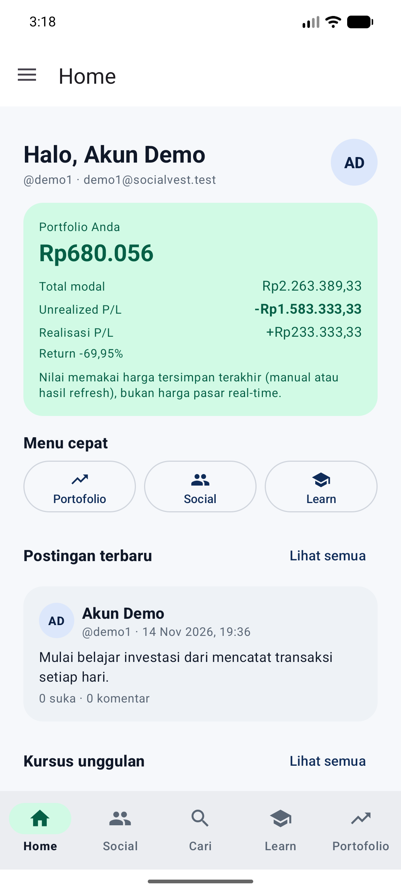
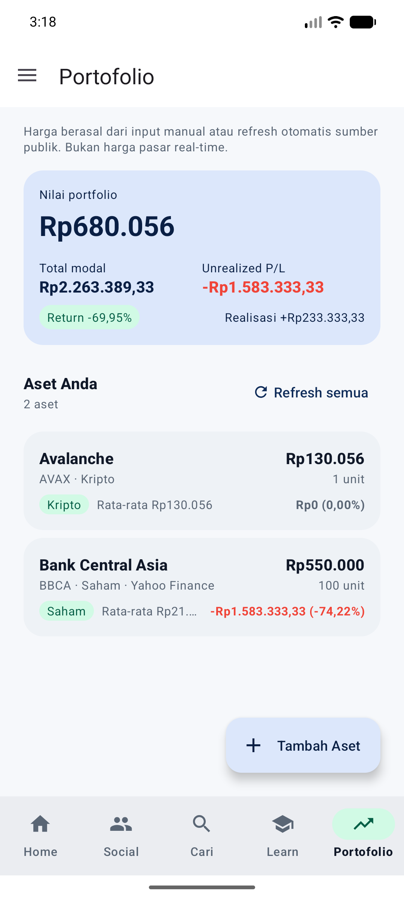
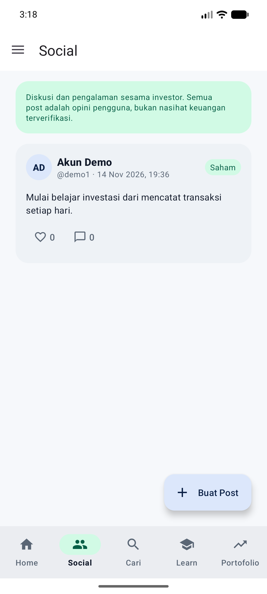
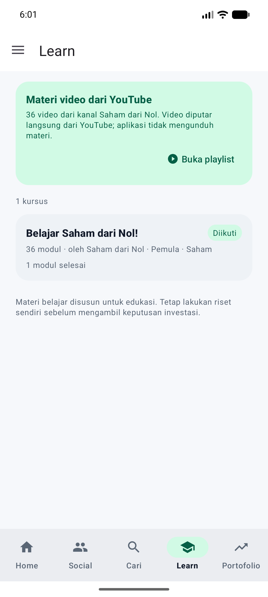
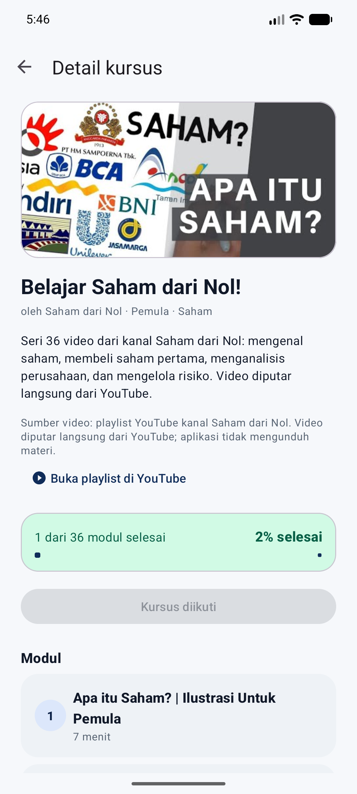
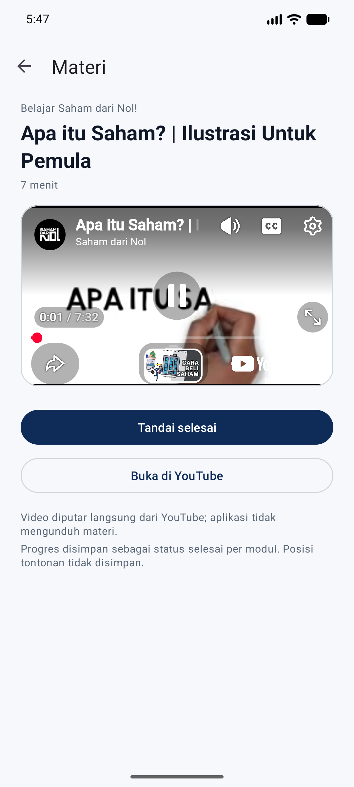
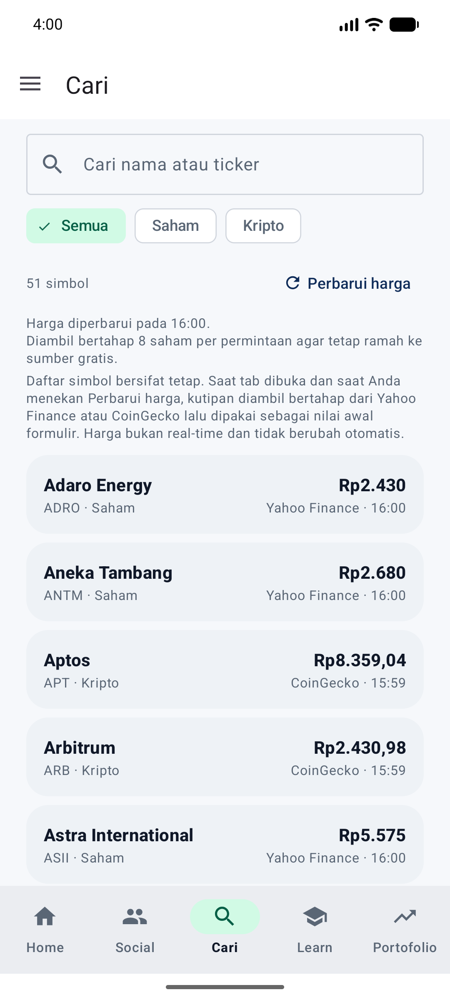
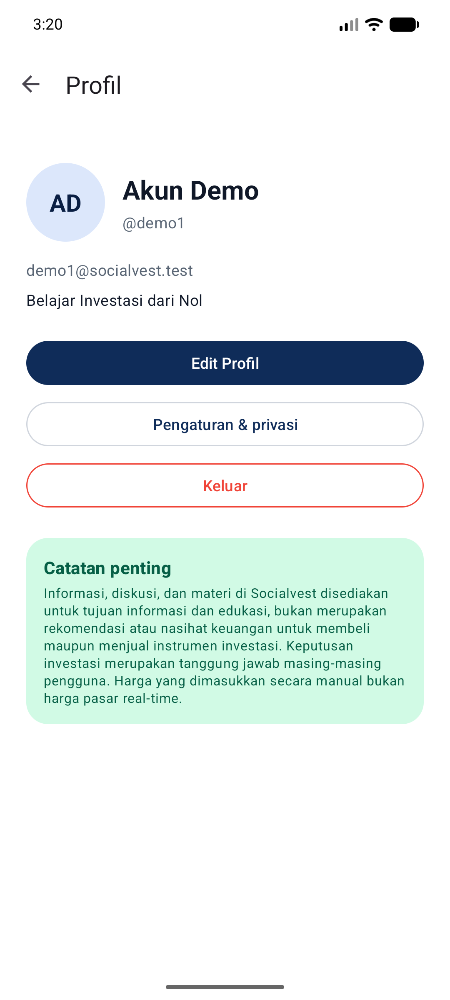
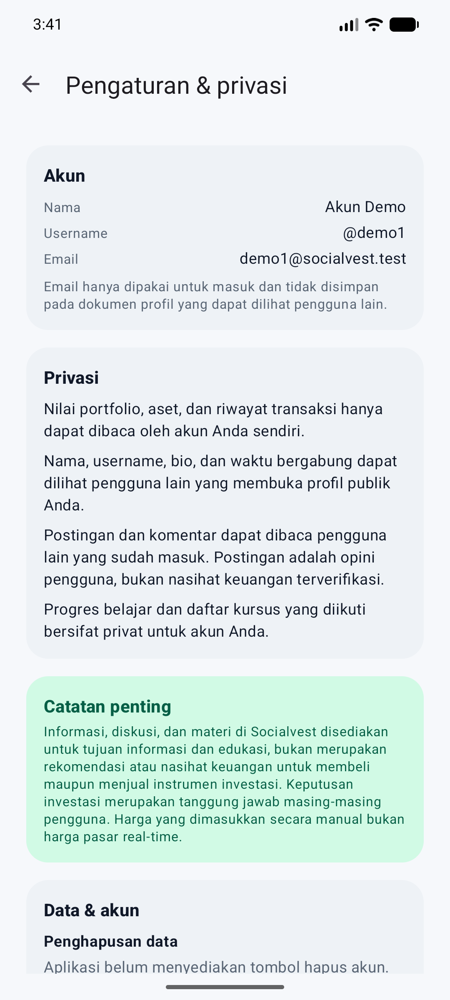
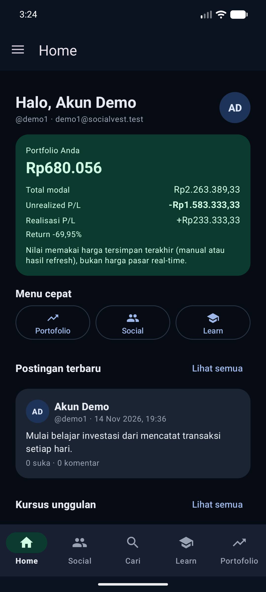

# Socialvest

Socialvest adalah aplikasi Android untuk **mencatat portofolio investasi** sekaligus
**belajar saham** dalam satu tempat. Semua data tersimpan di Firebase, dengan setiap
akun hanya bisa melihat dan mengubah portofolionya sendiri.

Dibangun dengan Kotlin, XML + View Binding, Material 3, dan Firebase (Authentication +
Cloud Firestore).



## Fitur

### Home
Ringkasan portfolio milik akun yang sedang masuk (nilai, modal, unrealized/realized P/L,
return), pratinjau 3 post terbaru dan 2 kursus unggulan, serta shortcut ke tab lain.

### Portofolio
- Tambah, edit, dan hapus aset saham, kripto, dan emas.
- Catat transaksi **BUY/SELL**; harga rata-rata, nilai aset, dan laba/rugi dihitung ulang
  dari riwayat transaksi (bukan diketik manual).
- Penjualan melebihi jumlah kepemilikan ditolak.
- **Refresh harga** semi-otomatis dari Yahoo Finance (saham IDX) dan CoinGecko (kripto),
  selalu disertai label sumber dan waktu pengambilan.

### Social
Feed komunitas untuk berbagi pengalaman: membuat/mengedit/menghapus post, like
anti-duplikat, komentar, dan profil publik pengguna lain. Setiap post ditandai sebagai
opini pengguna, bukan rekomendasi investasi.

### Cari
Katalog simbol saham IDX dan kripto dengan pencarian dan filter kategori. Kutipan harga
diambil bertahap agar tetap ramah ke penyedia data, lalu bisa langsung dipakai untuk
mengisi formulir aset.

### Learn
- Katalog kursus berbasis playlist YouTube **"Belajar Saham dari Nol!"** dari kanal
  **Saham dari Nol** — 36 video, urut sesuai playlist, langsung tersedia tanpa perlu
  menyiapkan data tambahan.
- Ikuti kursus (enroll), buka detail untuk melihat silabus dan durasi tiap modul.
- Video diputar lewat **embed resmi YouTube** di dalam aplikasi, dengan tombol
  **Buka di YouTube** sebagai alternatif.
- Tandai modul selesai; persentase dan jumlah modul selesai tersimpan per akun dan tetap
  ada setelah aplikasi ditutup.

### Lainnya
Tema Sistem/Terang/Gelap yang tersimpan, halaman Pengaturan, dokumen Syarat Penggunaan &
Kebijakan Privasi, serta catatan privasi yang jujur (tanpa toggle palsu).

## Tangkapan layar

| Portofolio | Social | Learn |
|---|---|---|
|  |  |  |

| Detail kursus | Player modul | Cari |
|---|---|---|
|  |  |  |

| Profil | Settings | Dark mode |
|---|---|---|
|  |  |  |

## Teknologi

| Bagian | Teknologi |
|---|---|
| Bahasa | Kotlin 2.4.21 |
| UI | XML, View Binding, Material 3, Navigation Component |
| Arsitektur | MVVM + Repository, `StateFlow` |
| Backend | Firebase Authentication, Cloud Firestore |
| Build | Android Gradle Plugin 9.4.1, Gradle 9.6.0 |
| SDK | `compileSdk 37`, `targetSdk 36`, `minSdk 24` |
| Uang & kuantitas | `Long` sen dan `Long` × 1.000.000, perkalian memakai `BigInteger`/`BigDecimal` |
| Pengujian | 90 unit test JVM (`PortfolioCalculatorTest`, `LearningTest`, `StarterCatalogTest`, dll.) |

Struktur paket utama:

```
app/src/main/java/com/socialvest/app
├── data/          model, remote (harga), repository (auth, investasi, sosial, learning)
├── domain/        kalkulasi portfolio, feed sosial, learning (StarterCatalog, YoutubeVideo), harga
├── ui/            auth, home, invest, social, search, learning, profile, settings
├── utils/         format uang, validasi, tema, image loader sederhana
└── viewmodel/     satu ViewModel per layar
```

## Persyaratan

- Android Studio (disarankan versi terbaru) atau JDK 17 + Android SDK Platform 37.
- Perangkat/emulator **Android 7.0 (API 24)** atau lebih baru.
- Koneksi internet (Firebase, YouTube, dan kutipan harga).

## Menjalankan dari source

```bash
git clone https://github.com/tmvillanda/socialvest.git
cd socialvest
```

1. Buka folder project di Android Studio, tunggu Gradle sync selesai.
2. Pastikan `local.properties` berisi `sdk.dir` yang benar (Android Studio membuatnya
   otomatis; file ini tidak disertakan di repo).
3. Jalankan `app` pada emulator atau perangkat.

Lewat command line:

```powershell
.\gradlew.bat :app:assembleDebug
.\gradlew.bat :app:testDebugUnitTest
```

APK hasil build ada di `app/build/outputs/apk/debug/app-debug.apk`.

> `app/google-services.json` disertakan agar build demo langsung terhubung ke project
> Firebase yang sama. Untuk penggunaan sendiri, ganti dengan konfigurasi Firebase Anda.

## Memasang APK

1. Buka halaman [Releases](https://github.com/tmvillanda/socialvest/releases/latest).
2. Unduh `app-debug.apk`.
3. Jika diminta, izinkan **Install unknown apps** untuk aplikasi browser/file manager.
4. Buka Socialvest, lalu pilih **Daftar** untuk membuat akun baru.

APK yang dibagikan adalah **debug build**: cukup untuk mencoba aplikasi, bukan untuk
distribusi produksi.

## Data dan privasi

- Portofolio, transaksi, enrollment, dan progres belajar terikat ke akun pembuatnya;
  pengguna lain tidak dapat membacanya (Firestore rules `userId == uid`).
- Feed Social dapat dibaca oleh semua pengguna yang sudah masuk. Jangan memposting data
  pribadi.
- Aplikasi tidak mengunggah foto dan tidak memakai Firebase Storage.

## Batasan yang diketahui

- Video Learn milik pihak ketiga; aplikasi hanya memutar/menautkan dari YouTube. Bila
  pemilik video membatasi embed, video tidak bisa diputar di aplikasi (gunakan tombol
  **Buka di YouTube**).
- Progres belajar menyimpan **status selesai** per modul, bukan posisi tontonan terakhir.
- Satu portofolio per akun, tanpa multi-currency dan tanpa grafik performa.
- Kutipan harga bukan real-time dan tidak diperbarui otomatis; selalu ada label sumber.
- Katalog Cari bersifat statis (51 simbol pilihan), bukan seluruh bursa.
- Notifikasi dan pilihan bahasa belum tersedia; keduanya dijelaskan secara jujur di
  dalam aplikasi.
- Penghapusan akun masih dilakukan manual oleh pengembang.

## Kredit

Materi video pada tab Learn dibuat oleh kanal YouTube **Saham dari Nol** dan tetap
menjadi hak milik pembuatnya. Aplikasi ini tidak mengunduh, menyimpan, atau mengunggah
ulang video; pemutaran dilakukan melalui embed resmi YouTube dan selalu menyertakan
tautan ke playlist aslinya.
